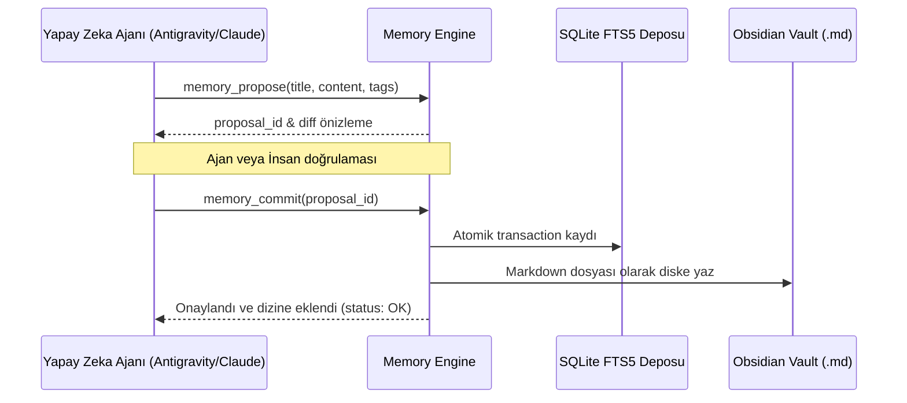

# 🏛️ Universal Memory Mimarisi (ARCHITECTURE.md)

Universal Memory; Antigravity, Claude Code ve Codex arasında paylaşılan, Git-benzeri iki aşamalı (propose/commit) çalışan kalıcı yapay zeka hafıza motorudur.

---

## 🧩 Katmanlar ve Bileşenler

```
universal-memory/
├── server.py           # Model Context Protocol (MCP) sunucusu (stdio üzerinden JSON-RPC)
├── memory_engine.py    # İki aşamalı öneri/onay döngüsü (propose, commit, handoff)
├── memory_index.py     # SQLite FTS5 tam metin araması ve Obsidian Markdown senkronizasyonu
├── second_brain.py     # Second Brain: ingest (damıt), graph (MOC), express (ADR/sürüm notu/brif)
├── distillation/       # Oturum sonu bilgi damıtma ve özetleme algoritmaları
└── schemas/            # Bellek kayıtları ve metadata JSON şemaları
```

---

## ⚡ İki Aşamalı Hafıza Döngüsü (Two-Phase Commit)



---

## 🛡️ Dokunulmaz Kurallar
1. **İki Aşamalı Yazma Güvencesi:** Ajanlar doğrudan kalıcı hafızaya körlemesine yazamaz; önce `propose` ile teklif edilir, doğrulandıktan sonra `commit` edilir.
2. **Kişisel Veri ve Gizlilik:** API anahtarları, şifreler ve oturum tokenları bellek indeksine kaydedilemez.

## ⏳ Bi-Temporal Model, Çelişki Çözümü ve Bağlam (v2.0)

| Kavram | Alan / Modül | Davranış |
|---|---|---|
| Geçerlilik zamanı | `valid_from` .. `valid_until` | `[from, until)` yarı açık; boş uç = açık. Alanı olmayan kayıt (sohbet) her zaman geçerli |
| İşlem zamanı | `ingestion_time`, `source_event_time` | Sistemin öğrendiği an / olayın gerçekleştiği an |
| Geçersiz kılma | `superseded_by`, `status: superseded`, `- supersedes: [[id]]` | Silme yok; zincir korunur |
| Zaman yolculuğu | `memory_search(as_of, include_invalid)` | Varsayılan: yalnızca şimdi geçerli olanlar |
| Çelişki çözümü | `conflict_resolver.analyze` | `reject_duplicate` / `supersede_candidates` / `create` |
| Hızlı yakalama | `quick_capture` | Önek → tür; canonical; çelişen eski kayıt anında kapanır |
| Damıtma | `distillation/worker.py` | Regex (negatif/karar/kural/görev) + opsiyonel yerel model |
| Bağlam paketi | `context_injector.build_context` | Geçerli kartlar, sorgu ilgisi, karakter bütçesi, agent_id kapsamı |

Akış: `memory_propose` → `conflict_resolver` (duplicate ise dur) → dosya `contradicts` bağlarıyla yazılır → `memory_commit` → çelişen canonical kayıtlar `bitemporal.supersede` ile kapatılır → indeks senkronize.

Tasarım notları: Graphiti'den bi-temporal pencere ve geçersiz kılma, Mem0'dan kapsam (`agent_id`/`run_id`) ve ekleme anında ADD/UPDATE/NONE kararı alındı. Çözücü deterministiktir (gömme/LLM yok); semantik benzerlik gerekirse `classify` arkasına eklenebilir. Avenox Beyin transkript damıtmaz (ajan kendi not yazar, `yakala` içerik yakalar); transkript damıtma bu repoda `worker.py` ile yapılır.

## 🧠 Second Brain Katmanı (CODE: Capture → Organize → Distill → Express)

`second_brain.py` çekirdeğe (bi-temporal, FTS5, propose/commit) dokunmaz; kasadaki normal kartları okur/yazar. Bağımlılığı yalnızca `memory_engine`, `memory_index`, `bitemporal`'dır.

| CODE | Araç | Girdi → Çıktı | Depo / indeks |
|---|---|---|---|
| Capture | `memory_capture` / `memory_propose` (mevcut) | tek satır / karar | `decisions/`, `lessons/` |
| Distill | `memory_ingest` | ham içerik → özet + çıkarımlar + alıntılar kartı | `resources/` (veya `lessons/`), `sync_vault()` ile FTS5, `source_commit` + `content_hash` mührü |
| Organize | `memory_graph` | etiket + anahtar kelime + wikilink → graf, kümeler, MOC | `files` + `memory_edges` (salt okunur) |
| Express | `memory_express` | kararlar + dersler + handoff → ADR raporu / sürüm notu / proje brifi | salt okunur |

- **Damıtma algoritması:** cümle bölme (zaman damgası temizliği, noktalamasız altyazılar ~30 kelimelik parçalara) → terim frekansı / √uzunluk × ipucu bonusu (`önemli`, `must`, `should`…) → yürütme özeti (2-3), çıkarımlar (3-5, aksiyon ipucu `- [ ]`), tırnaklı alıntılar, içgörüler. Cümleler kaynaktan birebir alınır; LLM/gömme yok.
- **Kademeli özetleme katmanları:** 0 = ham metin, 1 = **kalın** (en iyi 8 cümle), 2 = ==vurgu== (alıntı/içgörü), 3 = `Executive Summary`.
- **Bi-temporal uyum:** kartlar `ingestion_time`, `valid_from`, `valid_until`, `source_event_time`, `superseded_by` taşır. Graf ve brif yalnız şimdi geçerli kayıtları kullanır (`record_is_valid`); ADR raporu geçersiz kılınmış kararları tarihçe olarak durumuyla listeler. Kaynak kartları `context_injector`'a girmez (bağlam paketi şişmez).
- **Bağlantı eşiği:** `2 × ortak etiket + ortak anahtar kelime ≥ 3`; `quick-capture`/`negative` etiketleri sayılmaz. İngest sırasında yeni karta en ilgili 5 not `- related_to: [[id]]` ile bağlanır; `memory_index` bunları `memory_edges`'e yazar ve graf çift yönlü gösterir.
- **Güvenlik:** gizli anahtar kalıpları (`sk-`, `ghp_`, `AKIA`, `Bearer`, özel anahtar başlığı…) kartlara yazılmadan önce `[REDACTED]` yapılır; yol güvenliği `_safe_project_dir` ile sağlanır.
- **Dağıtım:** `second_brain` `server.REQUIRED_MODULES` listesindedir; `tools/sync_deploy.py` çalışan MCP kopyasına taşır.
