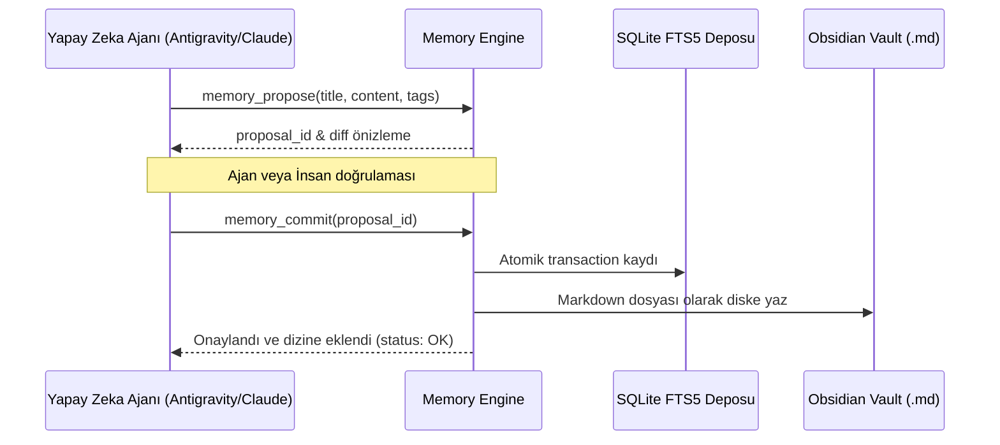

# 🏛️ Universal Memory Mimarisi (ARCHITECTURE.md)

Universal Memory; Antigravity, Claude Code ve Codex arasında paylaşılan, Git-benzeri iki aşamalı (propose/commit) çalışan kalıcı yapay zeka hafıza motorudur.

---

## 🧩 Katmanlar ve Bileşenler

```
universal-memory/
├── server.py           # Model Context Protocol (MCP) sunucusu (stdio üzerinden JSON-RPC)
├── memory_engine.py    # İki aşamalı öneri/onay döngüsü (propose, commit, handoff)
├── memory_index.py     # SQLite FTS5 tam metin araması ve Obsidian Markdown senkronizasyonu
├── distillation/       # Oturum sonu bilgi damıtma ve özetleme algoritmaları
└── schemas/            # Bellek kayıtları ve metadata JSON şemaları
```

---

## ⚡ İki Aşamalı Hafıza Döngüsü (Two-Phase Commit)



---

## 🛡️ Dokunulmaz Kurallar
1. **İki Aşamalı Yazma Güvencesi:** Ajanlar doğrudan kalıcı hafızaya körlemesine yazamaz; önce `propose` ile teklif edilir, doğrulandıktan sonra `commit` edilir.
2. **Kişisel Veri ve Gizlilik:** API anahtarları, şifreler ve oturum tokenları bellek indeksine kaydedilemez.
